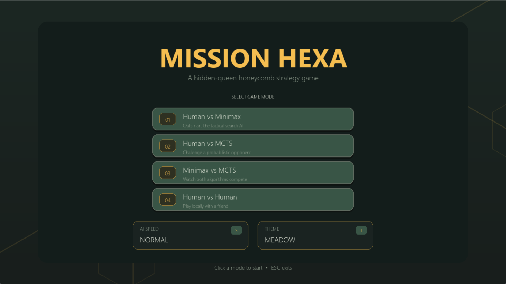
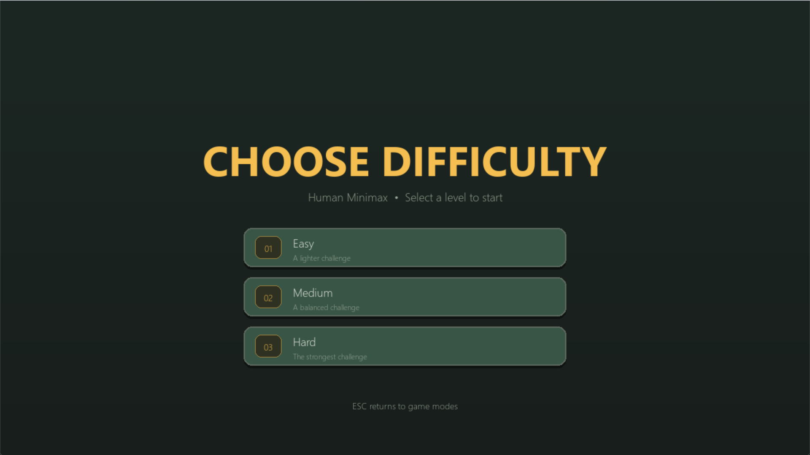
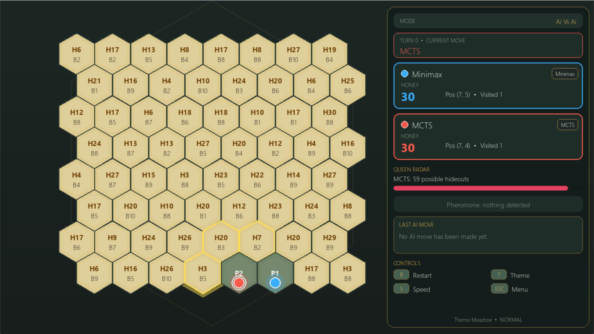
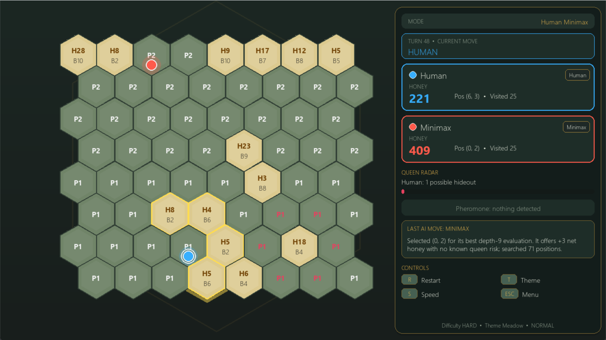
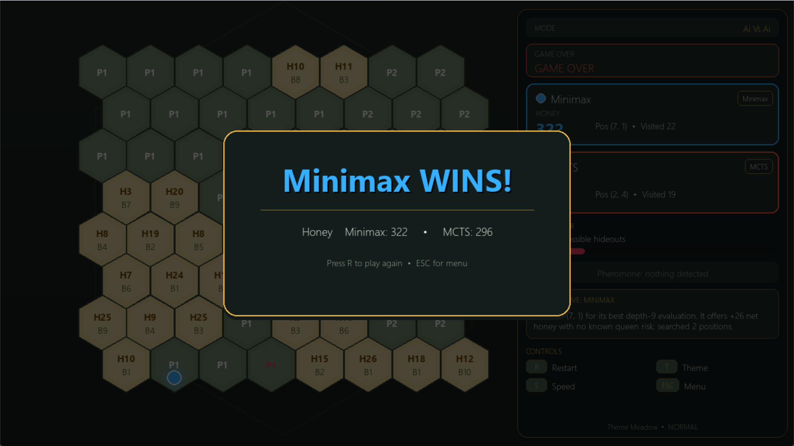
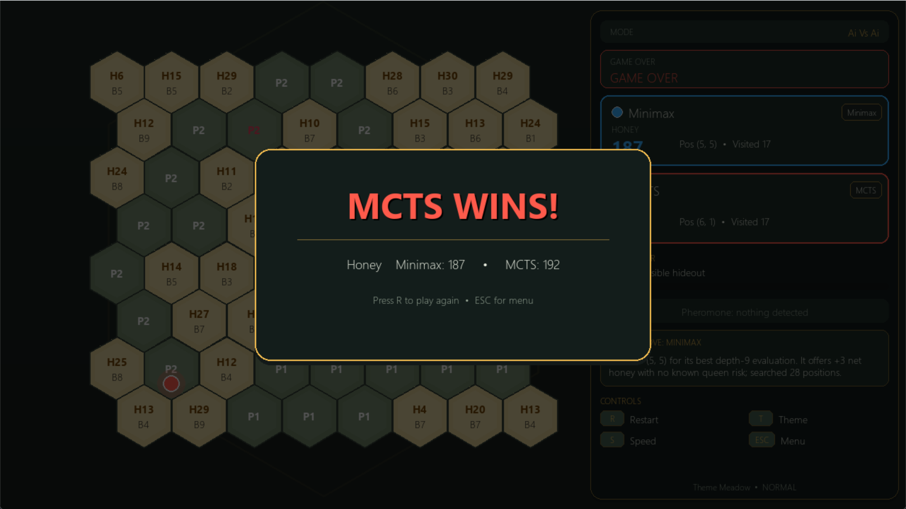

# Mission Hexa

Mission Hexa is a desktop strategy game built with Python and Pygame. Players explore a randomized honeycomb, manage honey and bee costs, use pheromone clues to narrow down the hidden Queen Bee's location, and try to outlast their opponent.

## Features

- An 8 x 8 hexagonal board with randomly generated cell resources and a hidden Queen Bee.
- Four ways to play: Human vs Minimax, Human vs MCTS, Minimax vs MCTS, and Human vs Human.
- Three AI difficulty levels for Human-vs-AI matches.
- Pheromone clues and a Queen Radar that help track possible Queen Bee locations.
- AI move explanations, player honey totals, legal-move highlighting, themes, and adjustable AI playback speed.
- Randomized boards and starting positions for replayable matches.

## Game overview

At the start of a match, every cell receives a honey value and a bee cost, and the Queen Bee is hidden in one cell. Both players begin with 30 honey at safe, distinct locations. The starting player is chosen at random.

Take turns moving to adjacent hexes. Each unvisited cell shows its honey reward (`H`) and bee cost (`B`). Collecting honey can fund later moves, but a player must have enough honey to pay the destination cell's bee cost. Plan routes carefully: visited cells cannot be entered again, and the opponent's occupied cell cannot be entered.

The goal is to avoid the hidden Queen Bee and finish with more honey than the opponent. Entering the Queen's cell eliminates that player and immediately awards the match to the opponent. If both players run out of legal moves, the player with more honey wins; equal totals result in a draw. A player with no legal move passes when the other player can continue. In AI-vs-AI mode, the match can also end early if one player is stuck and the active player already leads in honey.

### Pheromone clues

When a player visits a cell, they learn whether the Queen Bee is in one of that cell's neighboring hexes. A detected pheromone narrows the possible locations to neighboring cells; no detection rules those neighbors out. Each player's clues are tracked separately and summarized in the Queen Radar. The clue indicates proximity, not the Queen's exact cell.

## Rules and mechanics

1. **Move one adjacent hex:** Only unvisited neighboring cells are considered. You cannot move to the other player's occupied cell.
2. **Pay the bee cost:** A move is legal only if your current honey covers the cell's bee cost.
3. **Collect the cell's honey:** After paying, the cell's honey is added to your balance.
4. **Use clues to manage risk:** A visited cell reveals whether the Queen is among its neighbors. The Queen Radar reflects the current player's remaining candidates.
5. **Avoid the Queen:** Landing on the Queen's cell ends the match immediately in the opponent's favor.
6. **Win by survival and resources:** If play ends because neither player can move, the higher honey total wins.

The board shows honey and bee values on unvisited cells. Visited cells are marked by their owner, and legal destinations are highlighted. Resource values and the Queen's location are randomized for each match.

## Game modes

| Mode | Description |
| --- | --- |
| Human vs Minimax | Play against the Minimax search AI. Choose Easy, Medium, or Hard before the match starts. |
| Human vs MCTS | Play against the Monte Carlo Tree Search AI. Choose Easy, Medium, or Hard before the match starts. |
| Minimax vs MCTS | Watch the two algorithms play automatically. This mode uses Hard Minimax and Easy MCTS. |
| Human vs Human | Two people take turns playing on the same computer. |

Difficulty is chosen before a Human-vs-AI match and remains fixed for that match. AI Speed changes the delay between automated moves; it does not change the search difficulty.

## Algorithms used

### Minimax with alpha-beta pruning

The Minimax AI searches possible moves to a difficulty-dependent depth and uses alpha-beta pruning to skip branches that cannot improve the current decision. Its evaluation considers honey totals, promising future honey routes, available moves, mobility, and estimated Queen risk. Queen risk is estimated from the set of locations still consistent with the player's clues.

### Monte Carlo Tree Search

The MCTS AI uses the Upper Confidence Bound for Trees (UCT) to balance exploring less-visited moves against exploiting moves with strong results so far. It expands a search tree, runs simulated games from candidate positions, and backs up the rollout rewards. Rollouts sample a possible Queen location from the known candidate set and use a mixture of heuristic-guided and random moves. The final choice is the most-visited root move.

Both AIs avoid a Queen location when its position is certain. Their move selection also accounts for honey gained, future route opportunities, and Queen risk. MCTS rollouts run for up to 16 moves and usually choose from the three highest-ranked moves, while retaining some random exploration.

### Difficulty settings

| Difficulty | Minimax search depth | MCTS simulations per move |
| --- | ---: | ---: |
| Easy | 3 | 50 |
| Medium | 5 | 90 |
| Hard | 9 | 160 |

## Screenshots

### Home screen

Choose a game mode, set the AI playback speed, and switch the visual theme.



### Difficulty selection

Human-vs-AI modes ask for a difficulty before starting the game.



### AI vs AI

The board and sidebar show cell values, player resources, the current turn, legal moves, Queen Radar, and AI move information.



### Pheromone clues

The visited-cell clue and Queen Radar help narrow down possible locations of the hidden Queen Bee.



### Match results

Each match ends with a result overlay and the players' honey totals. Outcomes vary because the board and Queen location are randomized.





## Installation and running

You need Python and Pygame.

```bash
python -m pip install pygame
python main.py
```

On Windows, if the `python` command is unavailable, try `py`:

```powershell
py -m pip install pygame
py main.py
```

## Controls

| Input | Action |
| --- | --- |
| Mouse click | Select a mode/difficulty or move to a highlighted hex |
| `R` | Restart the current match |
| `T` | Cycle the visual theme |
| `S` | Cycle AI playback speed |
| `Esc` | Return to the menu; on the home screen, exit the game |

During difficulty selection, `Esc` returns to the game-mode menu.

## Tests

Run the project's unit tests with:

```bash
python -m unittest test_project.py
```

## Project structure

| File | Purpose |
| --- | --- |
| [`main.py`](./main.py) | Pygame application loop, menus, input handling, and AI turns |
| [`game.py`](./game.py) | Match state, turn handling, legal moves, and win conditions |
| [`board.py`](./board.py), [`hex_cell.py`](./hex_cell.py), [`player.py`](./player.py) | Board generation, cell data, player state, and clue tracking |
| [`minimax_ai.py`](./minimax_ai.py) | Minimax search with alpha-beta pruning |
| [`mcts_ai.py`](./mcts_ai.py) | UCT-based Monte Carlo Tree Search and rollouts |
| [`ai_heuristics.py`](./ai_heuristics.py) | Shared move-risk and honey-route heuristics |
| [`ui.py`](./ui.py), [`themes.py`](./themes.py), [`config.py`](./config.py) | Pygame rendering, themes, and game settings |
| [`test_project.py`](./test_project.py) | Unit tests for game rules and AI behavior |
